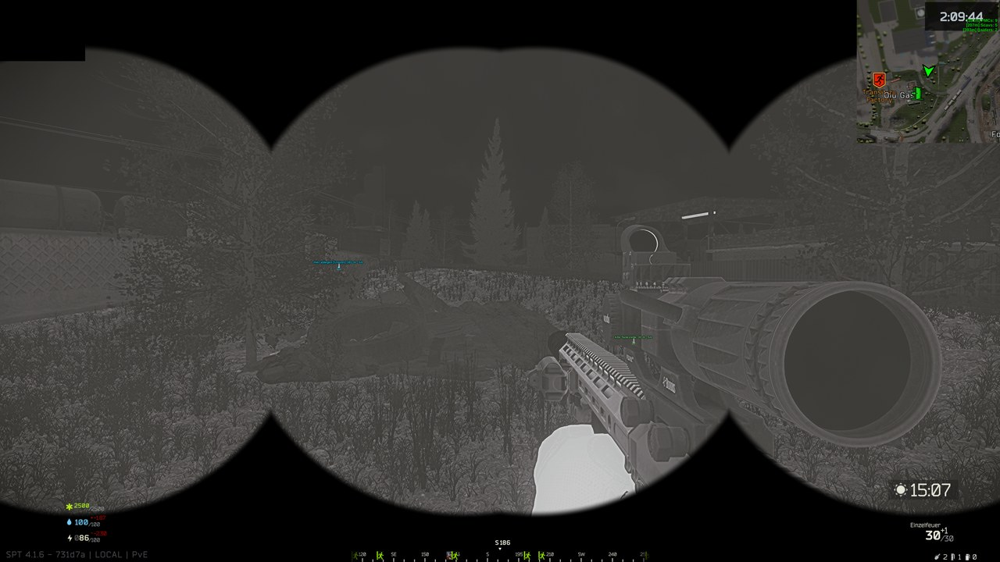

# GPNVG18Thermal (GPNVG-18 Thermal)

A new pair of goggles: it looks like the **GPNVG-18** (model, four tubes, flip mechanism) but shows the **thermal image of the T-7**.



## How this mod was made (AI disclosure)

This mod was **programmed by Claude**, an AI assistant made by Anthropic.
**Kaan was the tester**: Kaan has no programming background, played with the mod
on SPT 4.1.6, reported what went wrong, and Claude fixed it. No human programmer
has reviewed the code. It is open source so anyone can check it — if you find a
bug, please open an [issue](https://github.com/Kaanori/spt-gpnvg18thermal/issues).

## Requirements

- SPT 4.1.6 (server).
- Optional: [Borkel's Realistic Night Vision Goggles](https://sp-mod.com/mod/954) – the ZIP contains a BorkelRNVG entry (lens image used with Borkel's permission).

## Installation

1. Download `GPNVG18Thermal-1.1.0.zip` from the [Releases](https://github.com/Kaanori/spt-gpnvg18thermal/releases) page.
2. Extract it **into your SPT game folder** (the folder that contains `EscapeFromTarkov.exe`).
   The ZIP already has the right layout; the mod ends up in `SPT_Runtime/user/mods/GPNVG18Thermal/`.
   On Windows, make sure "Extract All" does not add an extra subfolder.
3. Restart the SPT server.

## Uninstall

Delete the mod's files from `SPT_Runtime/user/mods/GPNVG18Thermal/` (settings: `BepInEx/config/` for client mods) and restart the SPT server.

## How it works

Whether the client draws night vision or a thermal image depends only on the parent node of the template. So the T-7 is cloned (which keeps all thermal values) and only the appearance of the GPNVG-18 is applied on top: model, mask, weight, conflicts. The new ID is added everywhere the GPNVG-18 fits, including helmets from other mods (WTT & co.) that load later.

## Parts

| Folder | What |
|---|---|
| `src/` | Server mod (creates the goggles), settings in `config.json` |
| `Client/` | Client plugin: the GPNVG-18 model insists on a night-vision component. Without the patch it is missing and the whole helmet is not built. The plugin attaches the tube light to the switch of the thermal component. Since 1.1.0 it also draws the housing mask (see below). |
| `BorkelRNVG/` | Entry for **BorkelRNVG** (own folder, category "T-7 Thermal", GPNVG mask) |

## Housing mask (on/off, adjust)

Press **F12** (BepInEx Configuration Manager), section **"GPNVG-18 Thermal - Mask"**. All changes apply live while the goggles are down.

| Setting | Default | What it does |
|---|---|---|
| 1. Housing mask | on | Black GPNVG-18 housing around the four tubes. Off = thermal image on the whole screen. |
| 2. Size | 1.0 | Scales the whole mask (tubes and spacing). |
| 3. Horizontal offset | 0 | Moves the tubes left (−) / right (+), in screen heights. |
| 4. Vertical offset | 0 | Moves the tubes down (−) / up (+), in screen heights. |
| 5. Tube spacing | 1.0 | Distance between the tubes. |
| 6. Tube size | 1.0 | Size of each tube opening, spacing unchanged. |
| 7. Edge softness | 0.015 | Blur of the tube edges, 0 = hard. |
| 8. Housing opacity | 1.0 | 1 = solid black, lower = the thermal image shines through. |

The mask is generated at the screen's aspect ratio, so it always reaches the screen edges (16:9, 16:10, 21:9 …). It replaces the mask the game or BorkelRNVG would use, but only for these goggles and only for the head camera; the T-7 and thermal scopes are not touched. Settings are stored in `BepInEx/config/com.kaan.gpnvg18thermal.client.cfg`.

Black bars or a strange housing in 1.0.0? That came from the BorkelRNVG night-vision mask: it is an overlay for Borkel's own night-vision renderer (only 30 % dark outside the housing) and does not fit a full-screen thermal image. 1.1.0 no longer uses it.

Goes well with [WaermebildVisier](https://github.com/Kaanori/spt-waermebildvisier) (thermal scope).

## Credits

- `BorkelRNVG/Thermal/gpnvg18_thermal/lens.png` is an unchanged copy of the T-7 lens from **Borkel's Realistic Night Vision Goggles** (https://sp-mod.com/mod/954), included with Borkel's permission ([GitHub](https://github.com/Borkel/RealisticNVG-client-2/issues/10)). All credit for it goes to Borkel. The `mask.png` was made for this mod (fully transparent; BorkelRNVG needs the file, the client plugin draws the actual mask). The default tube layout follows BorkelRNVG's `quadnods` lens layout.
- The BorkelRNVG entry is optional: without BorkelRNVG the goggles still work with the game's own thermal view, and the housing mask settings work the same.

## Building from source

Needs the .NET 10 SDK and an SPT 4.1.6 installation to build against.

```bash
./build.sh             # Linux: build only
./build.sh --install   # build and copy into the game folder
```
```powershell
.\build.ps1            # Windows
.\build.ps1 -Install
```

The game folder is set in `Directory.Build.props` (Windows default `C:/SPT`)
or via the environment variable `SPT_DIR`.

## Support

Bugs and questions: [GitHub issues](https://github.com/Kaanori/spt-gpnvg18thermal/issues).

## License

MIT — see [LICENSE](LICENSE).
